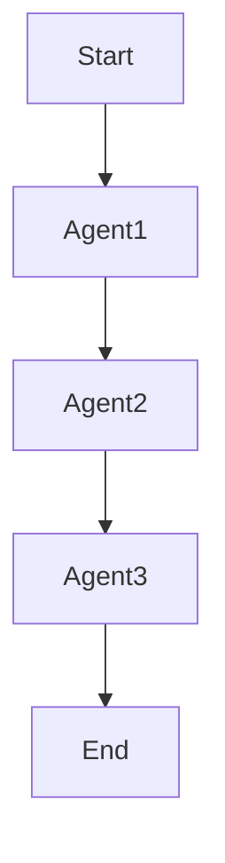
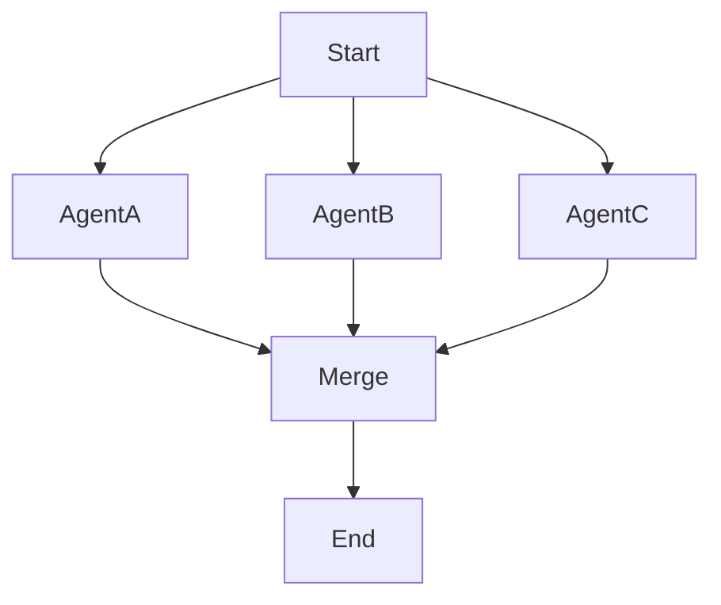
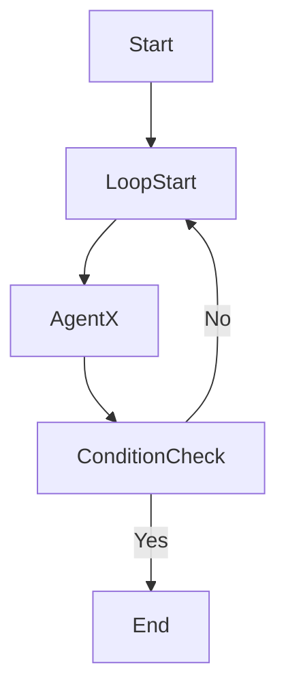

# Building AI Agents with AgentFlow: A Beginner's Journey

- Author: Kunal Kushwaha (https://kunalkushwaha.github.io/about/)
- Published: 2025-05-12
- Tags: AI Agents, Go, LLMs, Tutorial
- Canonical: https://kunalkushwaha.github.io/2025/05/12/building-ai-agents-with-agentflow/


Imagine you’re building an AI agent for the first time. You want it to translate text, summarize documents, or perhaps even plan tasks. But as you dive in, you realize that orchestrating these agents, managing their states, and ensuring smooth communication between them is more complex than anticipated.

Enter **AgentFlow**—a lightweight, Go-native framework designed to simplify the creation of event-driven AI agent workflows. With AgentFlow, you can focus on defining your agents’ behaviors, while the framework handles the orchestration, state management, and integration with large language models (LLMs) like OpenAI’s GPT-4.

In this blog post, I will introduce you to AgentFlow’s core concepts, demonstrate how to build a simple multi-agent workflow using LLMs, explore the built-in tracing functionality, and show how AgentFlow can streamline your AI development process.

---

## What is AgentFlow?

AgentFlow is a Go-based framework that enables developers to build AI agents as modular, event-driven components. Each agent is a simple Go function that processes an `Event`, updates a shared `State`, and returns a result. AgentFlow provides built-in orchestration patterns—such as sequential, parallel, and looped execution—to manage complex workflows with ease.

### Key Features

- **Modular Agent Design**: Define agents as individual Go functions, promoting code reusability and simplicity.
- **Built-in Orchestration**: Utilize predefined patterns like `SequentialAgent`, `ParallelAgent`, and `LoopAgent` to structure your workflows.
- **LLM Integration**: Seamlessly integrate with LLM providers like OpenAI, Azure OpenAI, and Ollama through a unified `ModelProvider` interface.
- **Observability**: Leverage the `agentcli` tool to trace and debug your workflows effectively.
- **Extensibility**: Enhance agent capabilities by registering custom tools and functions.

---

## Core Workflow Patterns

AgentFlow supports various orchestration patterns to manage how agents interact within a workflow. Let’s explore the primary patterns:

### Sequential Execution

Agents are executed one after another, with each agent receiving the updated state from the previous one.



### Parallel Execution

Multiple agents are executed concurrently, and their outputs are merged into a single state.



### Loop Execution

An agent or group of agents is executed repeatedly until a specified condition is met or a maximum number of iterations is reached.



---

## Building a Multi-Agent LLM Workflow

Let’s walk through creating a simple workflow that translates text into French and then summarizes it, using OpenAI’s GPT-4 model.

### Prerequisites

- Go installed on your system.
- An OpenAI API key set as the `OPENAI_API_KEY` environment variable.

### Step 1: Define the Agents

We’ll create two agents: one for translation and another for summarization. AgentFlow includes built-in support for LLMs via a `ModelProvider` interface, and you can access it through the context in your handlers. Here’s an example inspired by [opeanai example](https://github.com/kunalkushwaha/agentflow/blob/master/examples/openai_example/main.go):

```go
func TranslateAgent(ctx context.Context, ev core.Event, st core.State) (core.AgentResult, error) {
  provider := llms.GetProviderFromContext(ctx)
  input := ev.GetData()["text"].(string)

  prompt := fmt.Sprintf("Translate the following text to French:\n\n%s", input)
  translated, err := provider.Call(ctx, prompt)
  if err != nil {
    return core.AgentResult{}, err
  }

  st.Set("translated", translated)
  return core.AgentResult{OutputState: st}, nil
}

func SummarizeAgent(ctx context.Context, ev core.Event, st core.State) (core.AgentResult, error) {
  provider := llms.GetProviderFromContext(ctx)
  input := ev.GetData()["text"].(string)

  prompt := fmt.Sprintf("Summarize the following text:\n\n%s", input)
  summary, err := provider.Call(ctx, prompt)
  if err != nil {
    return core.AgentResult{}, err
  }

  st.Set("summary", summary)
  return core.AgentResult{OutputState: st}, nil
}
```

### Step 2: Set Up the Workflow

We’ll use the `ParallelAgent` to execute both agents concurrently.

```go
handlers := map[string]factory.AgentHandlerFunc{
  "translate": TranslateAgent,
  "summarize": SummarizeAgent,
}

flow := agents.NewParallelAgent([]string{"translate", "summarize"})

runner := factory.NewRunnerWithConfig(factory.RunnerConfig{
  Agents: handlers,
  Flow:   flow,
})
```

### Step 3: Execute the Workflow

Emit an event to start the workflow and retrieve the results.

```go
runner.Start(context.Background())
session := runner.Emit(core.NewEvent("parallel", core.EventData{"text": "Hello, AgentFlow!"}, nil))
trace := runner.DumpTrace(session)
result := trace[len(trace)-1].State
fmt.Println("Translated Text:", result.Get("translated"))
fmt.Println("Summary:", result.Get("summary"))
runner.Stop()
```

---

## Tracing Your Agent Workflow

AgentFlow includes built-in support for tracing, allowing you to inspect each step of your agent workflow—what data was passed, how state changed, and what each agent did.

When you run a workflow using `runner.Emit()`, AgentFlow collects a trace of each step. You can dump and inspect this trace using `runner.DumpTrace()`.

```go
// Emit the initial event
session := runner.Emit(core.NewEvent("parallel", core.EventData{"text": "Hello, AgentFlow!"}, nil))

// Dump and inspect the trace
trace := runner.DumpTrace(session)
for i, step := range trace {
  fmt.Printf("Step %d:\n", i+1)
  fmt.Printf("  Agent ID: %s\n", step.AgentID)
  fmt.Printf("  Input Event: %+v\n", step.InputEvent.Data)
  fmt.Printf("  Output State: %+v\n", step.State.Data)
}
```

### Example Output

```
Step 1:
  Agent ID: translate
  Input Event: map[text:Hello, AgentFlow!]
  Output State: map[translated:Bonjour, AgentFlow!]

Step 2:
  Agent ID: summarize
  Input Event: map[text:Hello, AgentFlow!]
  Output State: map[summary:An overview of AgentFlow.]
```

### Visualizing Workflow with `agentcli`

You can also use the `agentcli` tool to load and inspect trace files in a more visual or structured way:

```bash
agentcli trace --load trace.json --pretty
```

This makes it easier to debug workflows, compare outputs, and track down issues when agents don’t behave as expected.

---

## Getting Started

To explore AgentFlow further:

1. **Install AgentFlow**:

   ```bash
go get github.com/kunalkushwaha/agentflow@latest
```
2. **Explore Examples**:

   Navigate to the `examples/multi_agent` directory in the [AgentFlow repository](https://github.com/kunalkushwaha/agentflow/tree/master/examples/multi_agent) to see more complex workflows in action.
3. **Consult the Documentation**:

   Refer to the `docs` directory for detailed guides and architectural overviews.
4. **Use the CLI Tool**:

   Leverage `agentcli` to trace and debug your workflows effectively.

---

AgentFlow simplifies the process of building AI agent workflows in Go, allowing you to focus on your application’s logic rather than the intricacies of orchestration and state management. Whether you’re just starting with AI agents or looking to streamline your existing workflows, AgentFlow provides the tools and patterns to accelerate your development.

Explore AgentFlow today and experience a more straightforward approach to building AI-powered applications.
