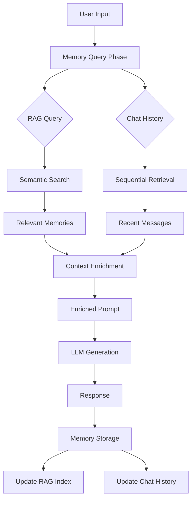

# Building Context-Aware AI Agents with Memory in AgenticGoKit

- Author: Kunal Kushwaha (https://kunalkushwaha.github.io/about/)
- Published: 2025-10-30
- Tags: AI Agents, AgenticGoKit, Go, Memory, RAG
- Canonical: https://kunalkushwaha.github.io/2025/10/30/context-aware-ai-agents-with-memory/


One of the biggest challenges in building AI agents is making them **remember**. Users expect conversational agents to recall previous interactions, maintain context across multiple turns, and provide personalized responses based on conversation history.

AgenticGoKit’s memory system solves this elegantly with a unified interface that supports:

- Conversation history - Sequential chat memory
- RAG (Retrieval Augmented Generation) - Semantic search over memories
- Memory tracking - Monitor memory usage and query performance
- Session management - Scope memories to conversation sessions

In this post, we’ll build a real interactive chat agent that demonstrates these features.

---

*Discover how to create conversational AI agents that remember past interactions and provide personalized, context-aware responses*

---

## The Memory Problem

Consider a simple conversation:

```
User: "My name is Sarah and I love hiking."
Assistant: "Nice to meet you, Sarah! Hiking is a wonderful activity."

User: "What do you know about me?"
Assistant: "I don't have any information about you."
```

Without memory, each interaction is isolated. The agent forgets everything immediately.

## The AgenticGoKit Solution

With AgenticGoKit’s memory system, the same conversation becomes:

```
User: "My name is Sarah and I love hiking."
Assistant: "Nice to meet you, Sarah! Hiking is a wonderful activity."
[Memory] 2 queries performed

User: "What do you know about me?"
Assistant: "Based on our conversation, I know your name is Sarah and you enjoy hiking!"
[Memory] 2 queries performed
```

The agent remembers! Let’s see how to build this.

## Setting Up Memory-Enabled Agent

### 1. Configuration

First, configure your agent with memory support:

```go
agent, err := vnext.NewBuilder("chat-assistant").
    WithConfig(&vnext.Config{
        Name: "chat-assistant",
        SystemPrompt: `You are a helpful and friendly chat assistant.
You remember details from our conversation and provide personalized responses.
Be conversational and engaging while being helpful.`,
        
        // LLM Configuration
        LLM: vnext.LLMConfig{
            Provider:    "ollama",
            Model:       "gpt-oss:120b-cloud",
            Temperature: 0.7,
            MaxTokens:   2000,
        },
        
        // Memory Configuration
        Memory: &vnext.MemoryConfig{
            Provider: "memory", // In-memory provider
            RAG: &vnext.RAGConfig{
                MaxTokens:       1000, // Context window for memories
                PersonalWeight:  0.8,  // Prioritize conversation history
                KnowledgeWeight: 0.2,  // Lower weight for knowledge base
                HistoryLimit:    20,   // Keep last 20 messages
            },
        },
        
        Timeout: 300 * time.Second,
    }).
    Build()

if err != nil {
    log.Fatalf("Failed to create agent: %v", err)
}

// Initialize the agent
if err := agent.Initialize(ctx); err != nil {
    log.Fatalf("Failed to initialize agent: %v", err)
}
defer agent.Cleanup(ctx)
```

### 2. Understanding Memory Configuration

Let’s break down the key memory settings:

**Provider Options:**

- `"memory"` - In-memory storage (simple, great for demos)
- `"pgvector"` - PostgreSQL with vector embeddings (production-ready)
- `"weaviate"` - Weaviate vector database
- Custom providers via plugin system

**RAG Configuration:**

- **MaxTokens**: Maximum tokens for retrieved context (affects prompt size)
- **PersonalWeight**: Priority for conversation history (0.0-1.0)
- **KnowledgeWeight**: Priority for knowledge base documents (0.0-1.0)
- **HistoryLimit**: Number of recent messages to include

**Pro Tip:** For conversational agents, set `PersonalWeight` higher (0.7-0.9) to prioritize recent dialogue over general knowledge.

## Building an Interactive Chat Loop

### Basic (Non-Streaming) Version

```go
scanner := bufio.NewScanner(os.Stdin)
conversationCount := 0

fmt.Println("Start chatting! Type 'quit' or 'exit' to end.")

for {
    fmt.Print("You: ")
    if !scanner.Scan() {
        break
    }

    userInput := strings.TrimSpace(scanner.Text())
    if userInput == "" {
        continue
    }

    if strings.ToLower(userInput) == "quit" {
        fmt.Println("Goodbye!")
        break
    }

    conversationCount++
    fmt.Printf("\nAssistant (Turn %d):\n", conversationCount)

    // Run agent with memory
    result, err := agent.Run(ctx, userInput)
    if err != nil {
        fmt.Printf("Error: %v\n\n", err)
        continue
    }

    // Display response
    fmt.Printf("%s\n", result.Content)

    // Show memory usage
    if result.MemoryUsed {
        fmt.Printf("\n[Memory] Used (%d queries)\n", result.MemoryQueries)
    }
    
    fmt.Printf("[Time] Response time: %v\n", result.Duration)
    fmt.Println(strings.Repeat("-", 60))
}
```

### Streaming Version (Real-time Token-by-Token)

For a more interactive experience, use streaming:

```go
stream, err := agent.RunStream(ctx, userInput)
if err != nil {
    fmt.Printf("Error: %v\n", err)
    continue
}

// Process streaming chunks
for chunk := range stream.Chunks() {
    switch chunk.Type {
    case vnext.ChunkTypeDelta:
        fmt.Print(chunk.Delta) // Print tokens as they arrive
        
    case vnext.ChunkTypeError:
        fmt.Printf("\nError: %v\n", chunk.Error)
        
    case vnext.ChunkTypeDone:
        fmt.Println() // New line after response
    }
}

// Get final result with memory stats
result, err := stream.Wait()
if err != nil {
    fmt.Printf("Error: %v\n", err)
    continue
}

fmt.Printf("\n[Memory] %d queries | [Time] %v\n", 
    result.MemoryQueries, result.Duration)
```

## How Memory Works Under the Hood

When you send a message to a memory-enabled agent, here’s what happens:



### 1. **Memory Query Phase** (Before LLM call)

```
Input: "What did we discuss earlier?"

Memory System performs:
├─ RAG Query: Semantic search for relevant past memories
│  └─ Returns: Top-k similar conversation snippets
│
└─ History Fetch: Get recent sequential messages
   └─ Returns: Last N conversation turns
```

Typically **2 queries per turn**:

1. One RAG semantic query
2. One chat history retrieval

### 2. **Context Enrichment**

The agent uses specialized APIs to combine context into an enriched prompt:

**Key APIs Used:**

- `EnrichWithMemory()` - Performs RAG semantic search and returns relevant memories
- `BuildChatHistoryContext()` - Retrieves recent conversation history
- `BuildEnrichedPrompt()` - Combines all context (system prompt, memories, history, user input)

**How it works in `agent.Run()`:**

```go
// Step 2: Enhance prompt with memory context if memory is enabled
// Use the new BuildEnrichedPrompt utility for proper RAG integration
memoryQueries := 0
if a.memoryProvider != nil && a.config.Memory != nil {
    // Convert llm.Prompt to core.Prompt for enrichment
    var corePrompt core.Prompt
    corePrompt, memoryQueries = BuildEnrichedPrompt(ctx, prompt.System, prompt.User, a.memoryProvider, a.config.Memory)

    // Update the LLM prompt with enriched content
    prompt.System = corePrompt.System
    prompt.User = corePrompt.User
}
```

The `BuildEnrichedPrompt` function internally:

1. Calls `EnrichWithMemory()` to get RAG context (counts as 1 query)
2. Calls `BuildChatHistoryContext()` to get chat history (counts as 1 query if performed)
3. Combines everything into the final enriched prompt

The agent combines:

- Your system prompt
- Retrieved memories (RAG results from `EnrichWithMemory`)
- Recent chat history (from `BuildChatHistoryContext`)
- Current user input

Into an enriched prompt sent to the LLM via `BuildEnrichedPrompt`.

### 3. **Response Generation**

The LLM generates a response using the enriched context.

### 4. **Memory Storage**

After response generation:

- User message is stored in memory
- Assistant response is stored in memory
- Both are available for future retrievals

### 5. **Result Tracking**

The `Result` object reports:

```go
result.MemoryUsed      // true if memory was accessed
result.MemoryQueries   // Number of queries performed
result.Duration        // Total execution time
result.TokensUsed      // LLM tokens consumed
```

## Real-World Example Output

Here’s what a real conversation looks like:

```
Interactive Chat Agent with Memory
===================================

You: My name is Sarah and I work as a software engineer in San Francisco.

Assistant (Turn 1):
Nice to meet you, Sarah! It's great to connect with a software engineer from 
San Francisco. The tech scene there is incredible! What kind of projects do 
you work on?

[Memory] Used (2 queries)
[Time] Response time: 3.2s
────────────────────────────────────────────────────────────

You: I mostly work on distributed systems and cloud infrastructure.

Assistant (Turn 2):
That sounds fascinating! Distributed systems and cloud infrastructure are 
critical areas in modern software engineering. Working on those systems in 
San Francisco must give you exposure to some cutting-edge technology. Are 
you working with any particular cloud providers or frameworks?

[Memory] Used (2 queries)
[Time] Response time: 3.5s
────────────────────────────────────────────────────────────

You: What do you know about me so far?

Assistant (Turn 3):
Based on our conversation, I know that:
- Your name is Sarah
- You work as a software engineer in San Francisco
- You focus on distributed systems and cloud infrastructure

These are really impressive areas of expertise! Is there anything specific 
about your work you'd like to discuss?

[Memory] Used (2 queries)
[Time] Response time: 3.1s
────────────────────────────────────────────────────────────
```

Notice how the agent:

1. Remembers the name “Sarah”
2. Recalls the job (software engineer in San Francisco)
3. References the technical specialization (distributed systems)
4. Maintains conversational context across turns

## Memory Query Counter Deep Dive

The memory query counter is particularly useful for:

### Performance Monitoring

```go
if result.MemoryQueries > 5 {
    log.Printf("Warning: High memory query count: %d", result.MemoryQueries)
}
```

### Understanding Memory Behavior

Typical query counts:

- 0 queries: Memory disabled or no memory configured
- 1 query: Only RAG or only history (unusual)
- 2 queries: Normal (1 RAG + 1 history fetch)
- 3+ queries: Multiple memory providers or custom implementations

### Cost Tracking

For production systems using vector databases:

```go
type ConversationMetrics struct {
    TotalTurns       int
    TotalMemQueries  int
    AvgQueriesPerTurn float64
}

metrics.TotalMemQueries += result.MemoryQueries
metrics.AvgQueriesPerTurn = float64(metrics.TotalMemQueries) / float64(metrics.TotalTurns)
```

## Advanced: RAG vs. Chat History

AgenticGoKit’s memory system uses **two complementary retrieval mechanisms**:

### 1. **RAG (Retrieval Augmented Generation)**

**How it works:**

- Converts text to embeddings
- Performs semantic similarity search
- Finds conceptually related memories

**Best for:**

- Finding relevant facts from many turns ago
- Semantic understanding (“what hobbies” finds “I like hiking”)
- Knowledge base queries

**Example:**

```
Turn 1: "I love hiking in the mountains"
Turn 20: "What outdoor activities do I enjoy?"
         ↓ RAG retrieves Turn 1 (semantically similar)
```

### 2. **Chat History**

**How it works:**

- Sequential retrieval
- Returns last N conversation turns
- Maintains dialogue flow

**Best for:**

- Recent context
- Conversation continuity
- Referencing “earlier” or “just now”

**Example:**

```
Turn 18: "I work in San Francisco"
Turn 19: "What city did I mention?"
         ↓ Chat history provides Turn 18
```

### Why Both?

```go
Memory: &vnext.MemoryConfig{
    RAG: &vnext.RAGConfig{
        PersonalWeight:  0.8,  // Chat history priority
        KnowledgeWeight: 0.2,  // RAG semantic search priority
        HistoryLimit:    20,   // Last 20 messages
    },
}
```

The weights balance:

- **High PersonalWeight**: Prioritizes recent dialogue context, ensuring conversational continuity and immediate relevance
- **High KnowledgeWeight**: Prioritizes semantic relevance over recency, better for knowledge-intensive tasks

**Why prioritize chat history for conversations?** Recent dialogue provides immediate context, maintains conversation flow, and ensures the agent remembers what was just discussed. This creates more natural, coherent interactions compared to jumping between semantically similar but temporally distant memories.

## Production Considerations

### 1. **Choose the Right Provider**

**Development/Testing:**

```go
Memory: &vnext.MemoryConfig{
    Provider: "memory", // In-memory, lost on restart
}
```

**Production:**

```go
Memory: &vnext.MemoryConfig{
    Provider: "pgvector",
    ConnectionString: os.Getenv("DATABASE_URL"),
    Embedding: &vnext.EmbeddingConfig{
        Provider: "ollama",
        Model:    "nomic-embed-text:latest",
    },
}
```

### 2. **Session Management**

Scope memories to user sessions:

```go
sessionID := memory.NewSession()
ctx = memory.SetSession(ctx, sessionID)

// All subsequent operations use this session
result, err := agent.Run(ctx, "Hello")
```

### 3. **Token Budget Management**

```go
RAG: &vnext.RAGConfig{
    MaxTokens: 1000, // Limit context size
    HistoryLimit: 10, // Fewer turns = lower costs
}
```

**Why this matters:**

- LLM APIs charge per token
- Larger context = higher costs per request
- Balance context quality vs. cost

### 4. **Error Handling**

```go
result, err := agent.Run(ctx, input)
if err != nil {
    log.Printf("Agent error: %v", err)
    continue
}

if !result.MemoryUsed {
    log.Println("Warning: Memory was not utilized")
}

if result.MemoryQueries == 0 {
    log.Println("Warning: No memory queries performed")
}
```

## Comparing: Memory vs. No Memory

Let’s see the difference side-by-side:

| Aspect | Without Memory | With Memory |
| --- | --- | --- |
| **Turn 1:** “My name is Alex” | “Nice to meet you, Alex!” | “Nice to meet you, Alex!"*[Memory] 2 queries* |
| **Turn 2:** “What’s my name?” | “I don’t know your name.” | “Your name is Alex!"*[Memory] 2 queries* |
| **Turn 3:** “What do I do?” | “I don’t have information about your profession.” | “I don’t recall you mentioning your profession yet. What do you do?"*[Memory] 2 queries* |
| **Turn 4:** “I’m a teacher” | “That’s interesting!” | “That’s wonderful! As a teacher, you must have many interesting stories to share."*[Memory] 2 queries* |
| **Turn 5:** “Tell me about myself” | “I don’t have personal information about you.” | “Based on our conversation, I know you’re Alex and you work as a teacher. You seem passionate about education!"*[Memory] 2 queries* |

### Without Memory (Code)

```go
agent, _ := vnext.QuickChatAgent("gpt-4o-mini")
// No memory configuration

result1, _ := agent.Run(ctx, "My name is Alex")
result2, _ := agent.Run(ctx, "What's my name?")
// Response: "I don't know your name"
```

### With Memory (Code)

```go
agent, _ := vnext.NewBuilder("agent").
    WithConfig(&vnext.Config{
        LLM: vnext.LLMConfig{
            Provider: "ollama",
            Model: "gpt-oss:120b-cloud",
        },
        Memory: &vnext.MemoryConfig{
            Provider: "memory",
            RAG: &vnext.RAGConfig{
                PersonalWeight: 0.8,
                HistoryLimit: 20,
            },
        },
    }).
    Build()

result1, _ := agent.Run(ctx, "My name is Alex")
// [Memory] 2 queries

result2, _ := agent.Run(ctx, "What's my name?")
// Response: "Your name is Alex!"
// [Memory] 2 queries
```

## Common Pitfalls & Best Practices

### Privacy & Data Security

**Pitfall:** Storing sensitive information in memory without user consent.

**Best Practice:** Always implement data retention policies and give users control over their data:

```go
// Clear user session data
if err := memoryProvider.ClearSession(ctx, sessionID); err != nil {
    log.Printf("Failed to clear session: %v", err)
}

// Implement data retention limits
Memory: &vnext.MemoryConfig{
    RetentionPolicy: &vnext.RetentionPolicy{
        MaxAge:     30 * 24 * time.Hour, // 30 days
        MaxEntries: 1000,                // Per session
    },
}
```

### Token Cost Explosion

**Pitfall:** Memory context grows unbounded, causing skyrocketing API costs.

**Best Practice:** Set reasonable limits and monitor usage:

```go
RAG: &vnext.RAGConfig{
    MaxTokens:    1000, // Limit context size
    HistoryLimit: 10,   // Limit conversation turns
}

// Monitor costs
if result.MemoryQueries > 5 {
    log.Printf("High memory usage detected: %d queries", result.MemoryQueries)
}
```

### Context Drift & Hallucinations

**Pitfall:** Outdated or irrelevant memories confuse the agent.

**Best Practice:** Use session management and implement relevance scoring:

```go
// Start new conversation sessions
sessionID := memory.NewSession()
ctx = memory.SetSession(ctx, sessionID)

// AgenticGoKit automatically handles session isolation
result, err := agent.Run(ctx, "Hello, I'm starting a new conversation")
```

### Performance Degradation

**Pitfall:** Memory queries slow down response times.

**Best Practice:** Choose appropriate providers and optimize configurations:

```go
// Development: Fast in-memory
Memory: &vnext.MemoryConfig{Provider: "memory"}

// Production: Optimized vector database
Memory: &vnext.MemoryConfig{
    Provider: "pgvector",
    Embedding: &vnext.EmbeddingConfig{
        Provider: "ollama",
        Model:    "nomic-embed-text:latest",
    },
}
```

### Over-Reliance on Memory

**Pitfall:** Agent becomes too dependent on past context, ignoring current instructions.

**Best Practice:** Balance memory weight with current context importance:

```go
RAG: &vnext.RAGConfig{
    PersonalWeight:  0.7,  // Memory context
    KnowledgeWeight: 0.3,  // Current/general knowledge
}
```

## Complete Working Example

Here’s the full code for a production-ready memory-enabled chat agent:

```go
package main

import (
    "bufio"
    "context"
    "fmt"
    "log"
    "os"
    "strings"
    "time"

    "github.com/kunalkushwaha/agenticgokit/core/vnext"
    _ "github.com/kunalkushwaha/agenticgokit/plugins/llm/ollama"
    _ "github.com/kunalkushwaha/agenticgokit/plugins/memory/memory"
)

func main() {
    ctx := context.Background()

    // Create agent with memory
    agent, err := vnext.NewBuilder("chat-assistant").
        WithConfig(&vnext.Config{
            Name: "chat-assistant",
            SystemPrompt: `You are a helpful and friendly chat assistant.
You remember details from our conversation and provide personalized responses.`,
            LLM: vnext.LLMConfig{
                Provider:    "ollama",
                Model:       "gpt-oss:120b-cloud",
                Temperature: 0.7,
                MaxTokens:   2000,
            },
            Memory: &vnext.MemoryConfig{
                Provider: "memory",
                RAG: &vnext.RAGConfig{
                    MaxTokens:       1000,
                    PersonalWeight:  0.8,
                    KnowledgeWeight: 0.2,
                    HistoryLimit:    20,
                },
            },
            Timeout: 300 * time.Second,
        }).
        Build()

    if err != nil {
        log.Fatalf("Failed to create agent: %v", err)
    }

    if err := agent.Initialize(ctx); err != nil {
        log.Fatalf("Failed to initialize agent: %v", err)
    }
    defer agent.Cleanup(ctx)

    fmt.Println("Chat Agent Ready!")
    fmt.Println("Try: 'My name is [name]' then ask 'What do you know about me?'")
    fmt.Println()

    scanner := bufio.NewScanner(os.Stdin)
    conversationCount := 0

    for {
        fmt.Print("You: ")
        if !scanner.Scan() {
            break
        }

        userInput := strings.TrimSpace(scanner.Text())
        if userInput == "" || strings.ToLower(userInput) == "quit" {
            break
        }

        conversationCount++
        fmt.Printf("\nAssistant (Turn %d):\n", conversationCount)

        result, err := agent.Run(ctx, userInput)
        if err != nil {
            fmt.Printf("Error: %v\n\n", err)
            continue
        }

        fmt.Printf("%s\n", result.Content)

        if result.MemoryUsed {
            fmt.Printf("\n[Memory] %d queries | [Time] %v\n", 
                result.MemoryQueries, result.Duration)
        }
        fmt.Println(strings.Repeat("-", 60))
    }

    fmt.Println("\nThanks for chatting!")
}
```

## Running the Examples

AgenticGoKit includes two complete demos:

### 1. Basic Memory Demo

```bash
cd examples/vnext/conversation-memory-demo
go run main.go
```

Features:

- Standard request/response flow
- Memory tracking and statistics
- Simple to understand and modify

### 2. Streaming Memory Demo

```bash
cd examples/vnext/conversation-memory-stream-demo
go run main.go
```

Features:

- Real-time token-by-token streaming
- Live memory query feedback
- Enhanced user experience

## Key Takeaways

1. **Memory makes agents conversational** - Context awareness transforms isolated Q&A into natural dialogue
2. **Two-tier retrieval is powerful** - RAG + chat history provides both semantic understanding and conversational flow
3. **Memory queries are trackable** - Monitor performance and costs with `result.MemoryQueries`
4. **Configuration is flexible** - Tune weights, limits, and providers for your use case
5. **Production-ready options exist** - Scale from in-memory prototypes to PostgreSQL/Weaviate production deployments

## Next Steps

- Explore the [Memory API documentation](https://docs.agenticgokit.com/reference/api/vnext/memory)
- Try the [streaming examples](https://github.com/AgenticGoKit/AgenticGoKit/tree/master/examples/vnext/conversation-memory-stream-demo)
- Check out [workflow memory patterns](https://docs.agenticgokit.com/reference/api/vnext/workflow)

## Resources

- **AgenticGoKit Repository**: [github.com/kunalkushwaha/agenticgokit](https://github.com/AgenticGoKit/AgenticGoKit)
- **Documentation**: [docs/reference/api/vnext/](https://docs.agenticgokit.com/reference/api/vnext/README)
- **Memory Examples**: [examples/vnext/conversation-memory-demo/](https://github.com/AgenticGoKit/AgenticGoKit/tree/master/examples/vnext/conversation-memory-demo)

---

*Built with AgenticGoKit v0.4.5 - The Go framework for production-ready AI agents*

---

### Contribute to AgenticGoKit

*Open-source Agentic AI framework in Go for building, orchestrating, and deploying intelligent agents. LLM-agnostic, event-driven, with multi-agent workflows, MCP tool discovery, and production-grade observability.*

AgenticGoKit is an open-source project that welcomes contributions! Whether you’re interested in:

- Adding new LLM providers or memory backends
- Improving documentation and examples
- Implementing new agent patterns or workflows
- Fixing bugs or adding features
- Writing tests and improving code quality

We’d love to have you join our community. Check out our [contributing guide](https://kunalkushwaha.github.io/2025/10/30/context-aware-ai-agents-with-memory/docs/contributors/) and [GitHub repository](https://github.com/AgenticGoKit/AgenticGoKit) to get started.
