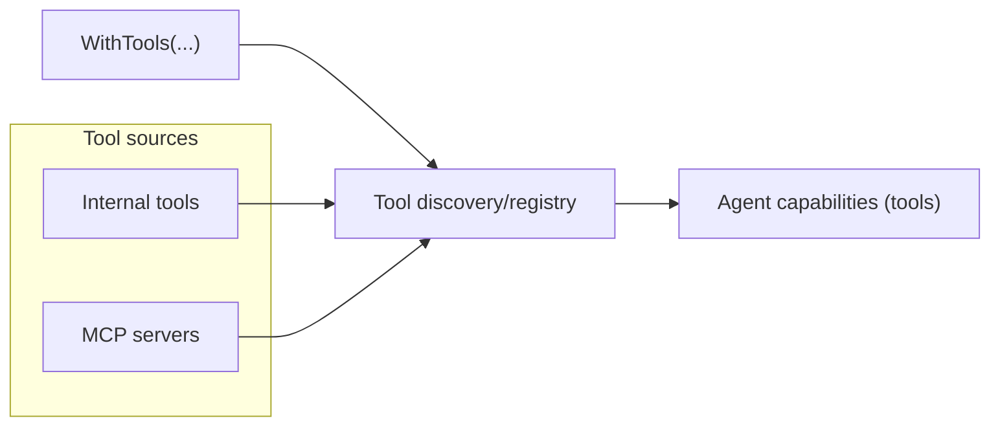
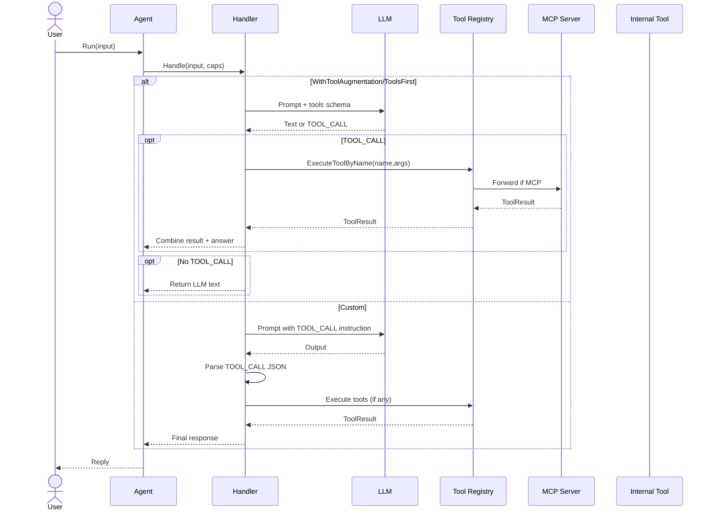
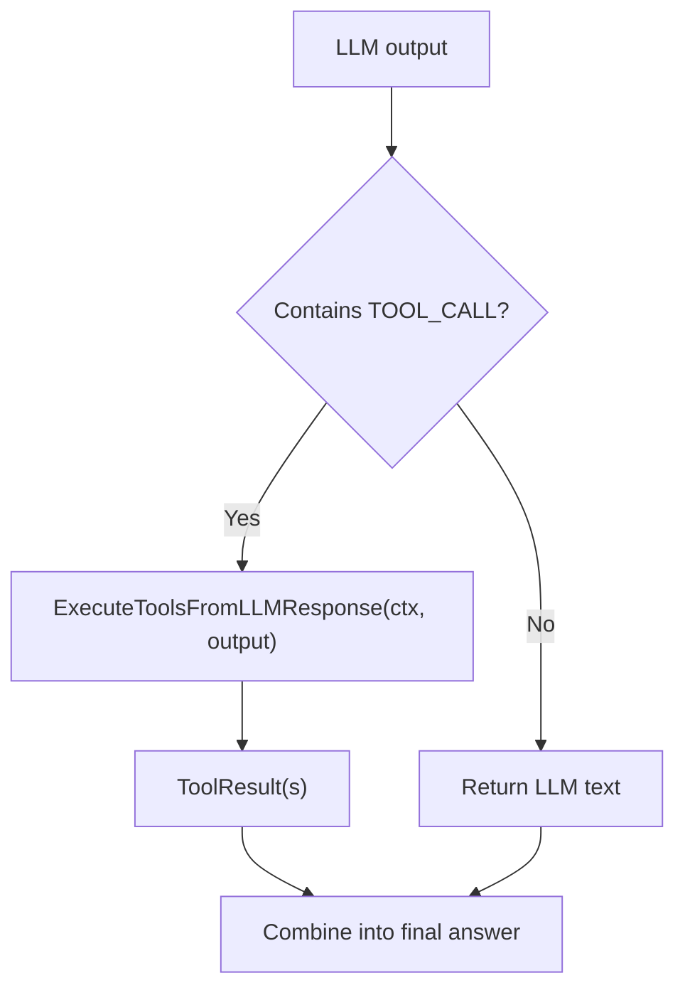

# Building AI Agents That Actually Do Things: Tools and MCP Made Simple in Go

- Author: Kunal Kushwaha (https://kunalkushwaha.github.io/about/)
- Published: 2025-11-06
- Tags: AI Agents, AgenticGoKit, Go, MCP, Tools
- Canonical: https://kunalkushwaha.github.io/2025/11/06/mcp-tools-with-agenticgokit/


If you’re new to building AI agents in Go, you might think integrating tools and external services is complex. **It’s not.** AgenticGoKit makes tools—including Model Context Protocol (MCP) tools—incredibly simple to use.

In this hands-on guide, you’ll discover how AgenticGoKit treats tools as first-class citizens, making your AI agents genuinely useful by connecting them to real-world capabilities. Whether you want to call APIs, run system commands, or integrate with external services, it’s just a few lines of Go code.

**What makes this different?** No complex setup, no wrestling with schemas, no boilerplate. Just clean, idiomatic Go that gets your agent talking to the world around it.

## What you’ll build

- An agent with tools enabled
- MCP tools via explicit server or automatic discovery
- Direct tool calls from Go
- LLM‑driven tool calls using a simple TOOL\_CALL JSON envelope

## Prerequisites

- Go 1.24+
- LLM provider plugin (examples use Ollama with `gemma3:1b`)
- Optional: An MCP server (e.g., HTTP SSE on `localhost:8812`) or use discovery

## Quick mental model

AgenticGoKit supports two tool sources:

- Internal tools: in-process functions you implement and register
- MCP tools: tools discovered from external MCP servers

Enable tools on the Builder and they become available to your agent. You can call them directly or let the LLM trigger them.

### Control how tools are invoked

`Builder.WithTools` wires tools (internal + MCP) into the agent’s capabilities. Choosing if/when to call tools is a policy—vNext leaves that up to your handler:

- Tool‑aware wrapper (`WithToolAugmentation`) = automatic tool execution when the model requests it
- `ToolsFirst` = a heuristic that tries tools first, then falls back to the LLM
- Custom handler = complete control (e.g., parse a `TOOL_CALL` JSON envelope)

Details below in “Choose your tool invocation policy.”

#### Diagram: tools at a glance



## Use internal tools (implement or reuse)

You can implement your own tool by satisfying the `vnext.Tool` interface and registering it. There’s also a built-in `echo` tool you can use immediately.

### Implement and register your own tool

```go
// 1) Implement the Tool interface
type helloTool struct{}

func (t *helloTool) Name() string        { return "hello" }
func (t *helloTool) Description() string { return "Greets a name you pass" }
func (t *helloTool) Execute(ctx context.Context, args map[string]any) (*vnext.ToolResult, error) {
  name, _ := args["name"].(string)
  if name == "" { name = "there" }
  return &vnext.ToolResult{ Success: true, Content: fmt.Sprintf("Hello, %s!", name) }, nil
}

// 2) Register it (e.g., in init() or main())
func init() {
  vnext.RegisterInternalTool("hello", func() vnext.Tool { return &helloTool{} })
}

// 3) Discover and call it
ctx := context.Background()
tools, _ := vnext.DiscoverTools() // includes internal tools
for _, t := range tools { fmt.Println(t.Name(), t.Description()) }

res, err := vnext.ExecuteToolByName(ctx, "hello", map[string]any{"name": "Kunal"})
if err == nil { fmt.Println(res.Content) }
```

### Reuse an existing internal tool (echo)

An `echo` tool ships out of the box. Call it directly:

```go
ctx := context.Background()
res, err := vnext.ExecuteToolByName(ctx, "echo", map[string]any{"message": "hello world"})
```

## 1) Enable tools on an agent

Explicit MCP server (HTTP SSE shown; adjust for your transport):

```go
agent, err := vnext.NewBuilder("mcp-agent").
  WithConfig(&vnext.Config{
    Name:         "mcp-agent",
    SystemPrompt: "You are a helpful assistant with access to tools.",
    Timeout:      60 * time.Second,
    LLM: vnext.LLMConfig{ Provider: "ollama", Model: "gemma3:1b" },
  }).
  WithTools(
    vnext.WithMCP(vnext.MCPServer{ Name: "tools", Type: "http_sse", Address: "localhost", Port: 8812, Enabled: true }),
    vnext.WithToolTimeout(30*time.Second),
  ).
  Build()
```

Prefer auto‑discovery? Scan common ports:

```go
agent, err := vnext.NewBuilder("mcp-discovery").
  WithConfig(&vnext.Config{ /* LLM + basics as above */ }).
  WithTools(vnext.WithMCPDiscovery(8080, 8081, 8090, 8100, 8811, 8812)).
  Build()
```

## Choose your tool invocation policy

By default, tools don’t auto‑run on `agent.Run()`. They’re available once configured, and you decide how they’re invoked. Pick one of these options:

1. Tool‑aware wrapper (automatic; no custom parsing)

```go
// Wrap an LLM-only handler so it can call tools when the model requests it
handler := vnext.WithToolAugmentation(vnext.LLMOnly("You are a helpful assistant."))

agent, err := vnext.NewBuilder("tool-auto").
  WithConfig(&vnext.Config{ /* LLM + basics */ }).
  WithTools(/* WithMCP or WithMCPDiscovery */).
  WithHandler(handler).
  Build()
```

Alternatively, use a prebuilt strategy that tries tools first and falls back to the LLM:

```go
handler := vnext.ToolsFirst("You are a helpful assistant with tools.")
```

2. Manual TOOL\_CALL parsing (complete control)

```go
handler := func(ctx context.Context, input string, caps *vnext.Capabilities) (string, error) {
  // Ask LLM to output TOOL_CALL{"name":..., "args":{...}}
  out, err := caps.LLM("Use tools when helpful and emit TOOL_CALL JSON.", input)
  if err != nil { return "", err }

  // Parse and execute any tool calls
  results, _ := vnext.ExecuteToolsFromLLMResponse(ctx, out)
  if len(results) > 0 && results[0].Success {
    return fmt.Sprint(results[0].Content), nil
  }
  return out, nil
}
```

### Sequence: policy options



Tip: In your main package, include blank imports for MCP transport/registry and an LLM provider (the examples already do this):

```go
import (
  _ "github.com/kunalkushwaha/agenticgokit/plugins/mcp/unified"
  _ "github.com/kunalkushwaha/agenticgokit/plugins/mcp/default"
  _ "github.com/kunalkushwaha/agenticgokit/plugins/llm/ollama"
)
```

## 2) List and call tools from code

```go
// List all tools (internal + MCP)
tools, _ := vnext.DiscoverTools()
for _, t := range tools {
  fmt.Printf("- %s: %s\n", t.Name(), t.Description())
}

// Execute a tool directly by name
res, err := vnext.ExecuteToolByName(ctx, "echo", map[string]any{"message": "hello"})
if err != nil { /* handle */ }
fmt.Println(res.Success, res.Content)
```

## 3) Let the LLM call tools (TOOL\_CALL)

Ask your model to emit this envelope when a tool helps:

```
TOOL_CALL{"name": "search", "args": {"query": "golang mcp", "max_results": 5}}
```

Parse and execute in one step:

```go
llmOutput := `Here is what I will do.\nTOOL_CALL{"name": "echo", "args": {"message": "from llm"}}`
results, _ := vnext.ExecuteToolsFromLLMResponse(ctx, llmOutput)
```

### Flow: TOOL\_CALL execution



## Try it now

Two runnable examples are included in the repo:

- [`examples/vnext/mcp-tools-blog-demo/`](https://github.com/AgenticGoKit/AgenticGoKit/tree/master/examples/vnext/mcp-tools-blog-demo) — minimal, annotated demo
- [`examples/vnext/mcp-integration/`](https://github.com/AgenticGoKit/AgenticGoKit/tree/master/examples/vnext/mcp-integration) — fuller example with both modes

```shell
# From repo root
"cd examples/vnext/mcp-tools-blog-demo; go run ."
```

## Practical tips

- If no tools appear: verify MCP server address/port or use discovery; ensure plugins are imported in your binary.
- When using TOOL\_CALL, make sure argument names/types match the tool’s schema.
- Caching is available; enable it when tools are expensive or frequently called.

## Links

- Repo examples:
  - [`examples/vnext/mcp-tools-blog-demo`](https://github.com/AgenticGoKit/AgenticGoKit/tree/master/examples/vnext/mcp-tools-blog-demo)
  - [`examples/vnext/mcp-integration`](https://github.com/AgenticGoKit/AgenticGoKit/tree/master/examples/vnext/mcp-integration)
- vNext APIs Documentation : [vNext API Reference](https://docs.agenticgokit.com/reference/api/vnext/README)

That’s it—treat MCP as just another tool source. Enable it, list tools, and either call them directly or let your LLM trigger them to deliver better answers.
