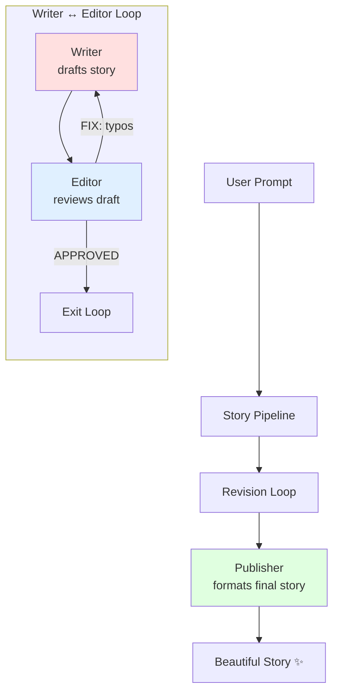

# Real-Time AI Editorial Workflows in Go: Loop, Revise, Publish with AgenticGoKit

> Build real-time AI editorial workflows in Go with AgenticGoKit — loop revisions, stream progress to a live UI, and publish polished stories.

- Author: Kunal Kushwaha (https://kunalkushwaha.github.io/about/)
- Published: 2025-11-16
- Tags: AI Agents, AgenticGoKit, Go, Workflows
- Canonical: https://kunalkushwaha.github.io/2025/11/16/loop-revise-publish-demo/


*Picture this:* You ask for a bedtime story. A Writer agent drafts it in seconds—intentionally making a few typos. An Editor agent reads it, spots “tyme” instead of “time,” and fires back with corrections. The Writer fixes the issues and resubmits. The Editor approves. A Publisher agent then polishes everything into a beautiful final piece.

**All of this happens automatically, and you watch it unfold in real-time.**

This isn’t science fiction—it’s what you can build in an afternoon with **AgenticGoKit**, a pure Go framework for orchestrating multi-agent AI workflows. No Python required. No heavyweight dependencies. Just clean, idiomatic Go that lets you compose AI agents like LEGO bricks.

---

## Why Golang developers will love this

If you’ve been envious of Python’s AI ecosystem, here’s your revenge:

- **Native Go**: No wrappers, no Python subprocesses. Pure, compiled Go performance.
- **Channels everywhere**: Streaming responses feel natural when your language was built for concurrency.
- **Type safety**: Your agents are strongly typed. Your workflow graph catches errors at compile time.
- **Deploy anywhere**: Single binary. No pip dependencies breaking in production. Ship it as a container, a Lambda, or bare metal.

The best part? The code actually makes sense. No magic decorators or hidden state—just explicit agent definitions and workflow composition.

---

## The demo: A mini creative studio in ~200 lines

Here’s what the `story-writer-chat-v2` example does:

1. **Writer Agent** drafts a story (we seed a couple typos to make the loop visible)
2. **Editor Agent** reviews and responds with either:
   - `FIX: tyme→time, happyness→happiness`
   - `APPROVED: [story text]`
3. **Loop continues** until approved (configurable max iterations; the example uses **3**)
4. **Publisher Agent** formats the final story with title and clean paragraphs

### What you see in the UI:


Agents “talk” to each other through streaming messages. It feels alive because the UI updates as each chunk arrives—just like watching ChatGPT type.

---

## Under the hood: How AgenticGoKit makes this trivial

### 1. Agents are just functions with personality

```go
// Example agent creation (match the demo's shape in `workflow/agents.go`)
writer, _ := vnext.QuickChatAgentWithConfig("Writer", &vnext.Config{
    Name:         "writer",
    SystemPrompt: WriterSystemPrompt,
    Timeout:      90 * time.Second,
    Streaming:    &vnext.StreamingConfig{Enabled: true, BufferSize: 50, FlushInterval: 50},
    LLM: vnext.LLMConfig{
        Provider:    cfg.Provider,
        Model:       cfg.Model,
        Temperature: 0.8,
        MaxTokens:   500,
        APIKey:      cfg.APIKey,
    },
})
```

That’s it. An agent is an LLM + config + optional memory. No inheritance hierarchies.

### 2. Loops are first-class workflows

```go
loopWorkflow, _ := vnext.NewLoopWorkflowWithCondition(&vnext.WorkflowConfig{
    Mode:          vnext.Loop,
    Timeout:       300 * time.Second,
    MaxIterations: 3,
}, vnext.Conditions.OutputContains("APPROVED"))

loopWorkflow.AddStep(vnext.WorkflowStep{Name: "write", Agent: writer})
loopWorkflow.AddStep(vnext.WorkflowStep{Name: "edit", Agent: editor})
```

The framework handles the cycling. You just define the exit condition.

### 3. Workflows compose into bigger workflows

```go
// Wrap the loop as a single agent
revisionLoop := vnext.NewSubWorkflowAgent("revision_loop", loopWorkflow, ...)

// Build the main pipeline
mainWorkflow.AddStep(vnext.WorkflowStep{Name: "revisions", Agent: revisionLoop})
mainWorkflow.AddStep(vnext.WorkflowStep{Name: "publish", Agent: publisher})

// Run it with streaming
stream, _ := storyPipeline.RunStream(ctx, userPrompt)
for chunk := range stream.Chunks() {
    // Handle start/text/complete/metadata/error
}
```

Nesting workflows is trivial—they’re just agents with extra steps. This is how you build complex orchestrations without losing your mind.

### 4. Transforms enforce contracts

```go
vnext.WorkflowStep{
    Name:  "edit",
    Agent: editor,
    // In the demo transforms are simple string->string helpers (see `workflow/transforms.go`).
    Transform: func(input string) string {
        return fmt.Sprintf(`Review this draft. Output either:
- FIX: word1→correction1, word2→correction2
- APPROVED: [story text]
Draft: %s`, input)
    },
}
```

Transforms let you massage inputs/outputs between steps. The Editor always gets instructions—the Writer never sees them. Clean separation of concerns.

---

## The visual flow



---

## Real-time streaming: The secret sauce

The demo includes a WebSocket server that converts agent events into UI updates:

```go
// Example (illustrative) stream handler that matches how the demo emits chunks.
type StreamHandler struct {
    wsConn *websocket.Conn
}

func (h *StreamHandler) OnChunk(chunk *vnext.StreamChunk) {
    switch chunk.Type {
    case vnext.ChunkTypeAgentStart:
        h.wsConn.WriteJSON(map[string]interface{}{"type": "agent_start", "agent": chunk.Metadata["step_name"]})
    case vnext.ChunkTypeText, vnext.ChunkTypeDelta:
        text := chunk.Content
        if chunk.Type == vnext.ChunkTypeDelta {
            text = chunk.Delta
        }
        h.wsConn.WriteJSON(map[string]interface{}{"type": "agent_chunk", "agent": chunk.Metadata["step_name"], "text": text})
    case vnext.ChunkTypeAgentComplete:
        h.wsConn.WriteJSON(map[string]interface{}{"type": "agent_complete", "agent": chunk.Metadata["step_name"], "metadata": chunk.Metadata})
    case vnext.ChunkTypeMetadata:
        h.wsConn.WriteJSON(map[string]interface{}{"type": "workflow_info", "meta": chunk.Metadata})
    case vnext.ChunkTypeError:
        h.wsConn.WriteJSON(map[string]interface{}{"type": "error", "error": chunk.Error.Error()})
    }
}
```

The frontend renders these as progressive chat messages. Users see agents “thinking” in real-time. It’s the UX polish that makes AI feel magical.

---

## Run it yourself in 60 seconds

```pwsh
git clone https://github.com/AgenticGoKit/agentic-examples
cd agentic-examples\story-writer-chat-v2

# Copy example env and edit it to match your provider
Copy-Item .env.example .env
# Edit `.env`: set `LLM_PROVIDER` and the matching API key variable.
# Examples:
#  - For OpenRouter: set `LLM_PROVIDER=openrouter` and `OPENROUTER_API_KEY=your-key`
#  - For OpenAI direct: set `LLM_PROVIDER=openai` and `OPENAI_API_KEY=your-key`

# Start backend
go mod tidy
go run main.go  # Runs on :8080

# In another terminal, start frontend
cd frontend
npm install
npm run dev  # Opens http://localhost:5173
```

Type: *“Write a short bedtime story about a tiny star that lost its sky.”*

Watch the Writer draft, the Editor critique, and the Publisher polish. It takes ~10 seconds.

---

## Extend it in 5 minutes: Real ideas that work

### Idea 1: Human-in-the-loop approval

```go
// Pause before publishing, wait for user confirmation
mainWorkflow.AddStep(vnext.WorkflowStep{
    Name:  "human_approval",
    Agent: humanApprovalAgent,  // Blocks until webhook/button press
})
```

### Idea 2: Add a tone coach

```go
toneCoach := vnext.QuickChatAgentWithConfig("tone_coach", llm, vnext.ChatConfig{
    SystemPrompt: "Rate tone (1-5). If < 4, suggest improvements.",
})
loopWorkflow.AddStep(vnext.WorkflowStep{Name: "tone_check", Agent: toneCoach})
```

### Idea 3: Parallel fact-checking

```go
parallelWorkflow := vnext.NewParallelWorkflow(cfg)
parallelWorkflow.AddStep(vnext.WorkflowStep{Name: "spell_check", Agent: spellChecker})
parallelWorkflow.AddStep(vnext.WorkflowStep{Name: "fact_check", Agent: factChecker})
```

All of these are ~10 lines of code. Seriously.

---

## Why AgenticGoKit exists

Python has LangChain and CrewAI. But if you’re a Go shop:

- **You’re not rewriting your infra in Python** just for AI workflows
- **You want proper testing**, not notebooks that break in production
- **You need to deploy to Lambda/Cloud Run/K8s** without containerizing Python runtimes
- **You value explicitness** over magic

AgenticGoKit gives you the good parts of agentic frameworks (composition, streaming, memory) without the Python tax.

---

## Why you should try

If you’re building:

- **Content pipelines**: Automate drafts, reviews, SEO optimization
- **Customer support**: Route → classify → respond → escalate workflows
- **Data processing**: Extract → validate → transform → summarize chains
- **Code review bots**: Analyze → suggest → apply → test loops

…you need orchestration that’s transparent, debuggable, and fast. AgenticGoKit delivers.

**The story-writer demo is intentionally simple**—it shows the core pattern without drowning you in complexity. Once you grok Writer ↔ Editor loops, you can build anything.

---

## Get started

- **GitHub**: [AgenticGoKit/agentic-examples](https://github.com/AgenticGoKit/agentic-examples)
- **Docs**: <https://docs.agenticgokit.com/>
- **Discord**: *[Join our community](https://discord.gg/AWuEgVSTNg)*

Clone the repo. Run the demo. Break it. Build something weird.

Then show us what you made—we love seeing creative hacks. 🚀

---

*P.S. If you build a story-writer that uses an LLM to argue about serial commas, please tag us. We need to see this.*
